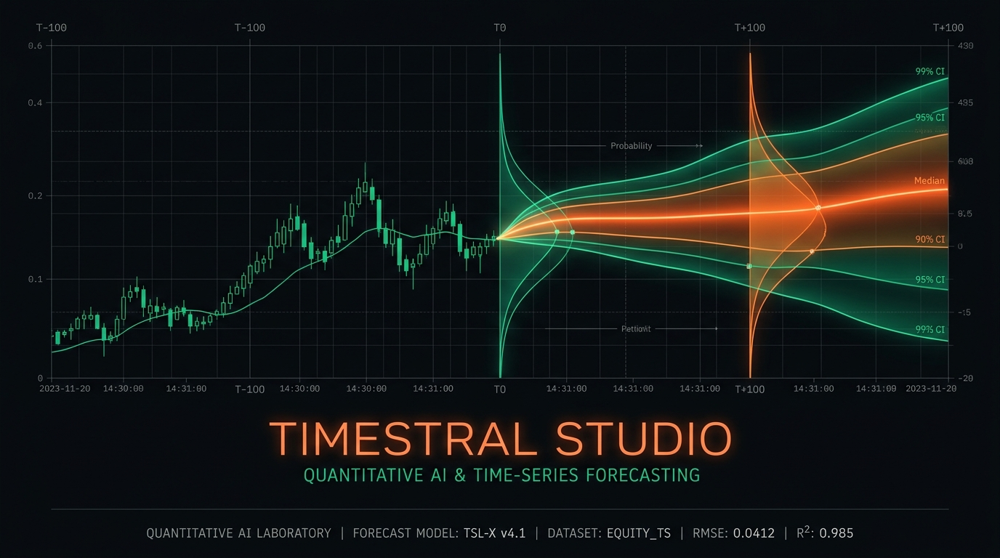
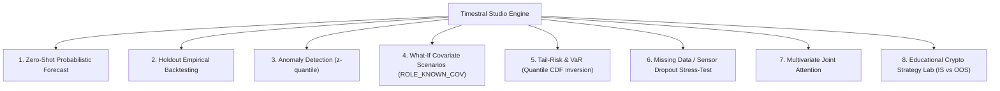

# Timestral Studio

[](LICENSE)
[](https://www.python.org/)
[](https://www.raspberrypi.com/products/raspberry-pi-5/)
[](https://huggingface.co/collections/mistralai/timestral)
[](http://localhost:8765/docs)
[](http://localhost:8765/api/v1/agent-schema)

> **Timestral Studio** is a time-series engineering suite and predictive laboratory built on **Mistral Timestral** foundation models (`Timestral-5M`, `28M`, `123M`, `209M`). It combines a high-density quantitative dashboard for empirical benchmark verification (*holdout backtesting*), an educational quantitative strategy lab, and a comprehensive set of high-performance API endpoints for AI Agents (supporting OpenAI / Mistral Function Calling and Model Context Protocol - MCP).

---

> [!WARNING]
> ### ⚠️ FINANCIAL DISCLAIMER / NOTICE
>
> This software and the **Crypto Trading Workbench** (`/crypto`) are developed and distributed **strictly for educational, academic, and scientific research demonstration purposes only** to investigate the probabilistic properties of machine learning models on numerical series.  
> **IT DOES NOT CONSTITUTE IN ANY WAY FINANCIAL ADVICE, INVESTMENT RECOMMENDATIONS, OR SOLICITATION FOR TRADING.**  
> The generated signals (BUY, SELL, HOLD), simulated equity curves, and statistical metrics (Profit Factor, Win Rate, Max Drawdown) are purely theoretical mathematical outputs. They **cannot guarantee future market returns or anticipate real-world market turbulence**. Any real financial market operation involves significant financial risk, including the loss of all invested capital. The author (`BalTac`) and contributors assume no liability whatsoever for any actions taken or economic losses incurred through the direct or indirect use of this software or its APIs.

---

## Attributions & Acknowledgments

* **[Mistral AI](https://mistral.ai/)**:
  For inventing, training, and open-sourcing the **Timestral** model family (Decoupled Horizon Forecasting, patch-based causal attention, and 21 non-crossing quantiles under Apache 2.0).
  - Technical Announcement: [https://mistral.ai/news/timestral](https://mistral.ai/news/timestral)
  - Official GitHub Repository: [https://github.com/mistralai/timestral](https://github.com/mistralai/timestral)
  - Hugging Face Model Collection: [https://huggingface.co/collections/mistralai/timestral](https://huggingface.co/collections/mistralai/timestral)
* **[Binance Public API](https://api.binance.com/)**:
  For providing public market OHLCV candle streams for the educational crypto demonstrations (BTC/USDT and ETH/USDT).
* **Author & Maintainer**:
  - **BalTac** ([GitHub @BalTac](https://github.com/BalTac)) — Platform architecture, single-slot Raspberry Pi 5 memory management, AI Agent discovery API, educational crypto laboratory, and automated test suite.

---

## Native Architecture & Capabilities

Timestral processes causal context sequences of up to **32,768 steps**, producing at each horizon step **21 non-crossing quantiles**:
`0.01, 0.05, 0.10, 0.15, 0.20, 0.25, 0.30, 0.35, 0.40, 0.45, 0.50, 0.55, 0.60, 0.65, 0.70, 0.75, 0.80, 0.85, 0.90, 0.95, 0.99`

Timestral Studio implements and visually documents **all 7 native operational modes**:



### 1. Zero-Shot Probabilistic Forecasting (`POST /api/v1/forecast`)
Multi-step probabilistic prediction with median (`q50`) and uncertainty cones (80%, 90%, 98% Confidence Intervals), automatic non-negative clamping, and symmetric averaging (`clampsym`).

### 2. Empirical Holdout Benchmark (`POST /api/v1/backtest`)
Withholds the last $H$ time steps as hidden ground truth, forecasts the horizon using only antecedent context, and computes strict empirical metrics:
- **MAE** (Mean Absolute Error)
- **RMSE** (Root Mean Squared Error)
- **sMAPE** (Symmetric Mean Absolute Percentage Error)
- **Coverage Ratio 80% & 90%** (percentage of ground truth residing within `q10–q90` and `q05–q95`)
- **Pinball Loss** across all 21 quantiles
- Direct comparison against a **Seasonal Naive** baseline.

### 3. Multi-Model Comparison (`POST /api/v1/backtest/compare-models`)
Multi-checkpoint benchmarking (`5M` vs `28M` vs `123M` vs `209M`) evaluating step latency, RAM consumption, and error reduction.

### 4. Zero-Shot Anomaly Detection (`POST /api/v1/anomalies`)
Scores observed empirical values against Timestral's predicted quantile envelope, detecting anomalies with normalized *z-quantile severity scores*.

### 5. What-If Counterfactual Scenarios (`POST /api/v1/scenario`)
Leverages `ROLE_KNOWN_COV` (`known_covariates` tensor of shape `(B, C_known, T + H)`) to simulate the future impact of planned interventions (pricing adjustments, maintenance shutdowns, promotions) against an unperturbed baseline.

### 6. Tail-Risk & Value at Risk (VaR) (`POST /api/v1/risk`)
Inverts the empirical CDF across the 21 quantile levels to compute exact threshold-breach probabilities $P(Y_t > \tau)$, step-wise `VaR_95`, `VaR_99`, and tail asymmetry.

### 7. Sensor Dropout & Missing Data Stress-Test (`POST /api/v1/missing-stress`)
Injects `NaN` gaps and sets `observation_mask=False` in historical context, proving model attention resilience under noisy or interrupted data capture.

### 8. Joint Multivariate Forecasting (`POST /api/v1/multivariate`)
Simultaneously forecasts coupled variables (e.g. *Power Grid Load*, *Ambient Temperature*, *Solar Radiation*) leveraging cross-variate attention layers.

### 9. Crypto Strategy Lab (`/crypto` · `POST /api/v1/crypto/backtest`)
- **Real-Time Probabilistic Signals**: Asymmetric evaluation of median expected drift ($q50$) against tail risk ($q10$).
- **Walk-Forward In-Sample (IS) vs Out-of-Sample (OOS) Splitting**: Strict blind validation on unseen data to safeguard against overfitting.
- **Financial Performance Indicators**:
  - **Profit Factor**: Gross Profit / Gross Loss ($>1.5$ optimal).
  - **Win Rate %**: Percentage of profitable closed trades.
  - **Max Drawdown %**: Peak-to-trough maximum drawdown computed on continuous mark-to-market equity.
  - **Annualized Sharpe Ratio**: Risk-adjusted excess return over volatility.
- **Manual Investment Simulator (`POST /api/v1/crypto/simulate-investment`)**: Real-time evaluation of expected net yield, bull/bear scenarios, win probability, and liquidation risk across leverage tiers (1x Spot, 2x, 3x, 5x).

---

## AI Agent Discovery Directory (LLM / MCP)

All discovery endpoints execute with zero model loading overhead and zero RAM consumption during idle state:

| Endpoint | Format | Target Audience | Purpose |
|---|---|---|---|
| `GET /health` | JSON | AI Agents & Humans | Health status, Pi 5 telemetry, cached models catalog, and full route index |
| `GET /docs` | HTML | Humans & Developers | Interactive **Swagger UI** (OpenAPI 3.1) |
| `GET /doc` | JSON | AI Agents & Humans | Fast structured API reference guide |
| `GET /redoc` | HTML | Humans & Developers | Structured **ReDoc** technical documentation |
| `GET /openapi.json` | JSON | AI Agents & Tool Generators | Complete machine-readable OpenAPI 3.1 specification |
| `GET /readme` | Markdown | AI Agents & Humans | This README documentation in raw Markdown |
| `GET /llms.txt` | Text | AI Agents & LLMs | Standard compact discovery manifest for instant LLM context ingestion |
| `GET /api/v1/agent-schema` | JSON | AI Agents | Ready-to-use tool schemas for **OpenAI / Mistral Function Calling** and **MCP** |

---

## Raspberry Pi 5 Hardware & Memory Lifecycle

Engineered specifically for edge environments with bounded RAM and thermal budgets:
* **Snappy Default Model (`5M` · 21 MB)**: Instant CPU inference (~50ms) for ultra-fast response times.
* **On-Demand Scaled Checkpoints (`28M`, `123M`, `209M`)**: Loadable via `model_size` argument from either the web UI or API calls.
* **Single-Slot Memory Policy**: At most one model checkpoint is loaded in RAM at any time; switching unloads the previous model and invokes `gc.collect()`.
* **Automatic 300-Second Idle TTL Eviction**: After 5 minutes of idle time without inference requests, model weights are purged from RAM, returning the process to base idle footprint (~240 MB RSS).
* **Live Hardware Telemetry**: Continuous monitoring of SoC CPU temperature, 1m/5m load averages, and system RAM via `/proc` and `/sys`.

---

## Installation & Quickstart

### 1. Clone Repository
```bash
git clone https://github.com/BalTac/timestral-studio.git
cd timestral-studio
```

### 2. Set Up Virtual Environment
```bash
python3 -m venv .venv
source .venv/bin/activate
pip install -r requirements.txt
```

### 3. Launch Development Server
```bash
.venv/bin/python -m uvicorn app:app --host 0.0.0.0 --port 8765
```
Open in browser:
* **Main Studio Workbench**: `http://localhost:8765/`
* **Crypto Strategy Lab**: `http://localhost:8765/crypto`
* **Swagger API UI**: `http://localhost:8765/docs`

### 4. Run Self-Check Test Suite
```bash
.venv/bin/python test_app.py
```

### 5. Run as Linux / Raspberry Pi Systemd Service
To ensure persistent background operation with automatic boot startup:
```bash
sudo cp /etc/systemd/system/timestral.service /etc/systemd/system/timestral.service
sudo systemctl daemon-reload
sudo systemctl enable timestral.service
sudo systemctl start timestral.service
sudo systemctl status timestral.service
```

---

## License

This project is licensed under the **Apache License 2.0**.  
See the [LICENSE](LICENSE) file for the complete license terms.
