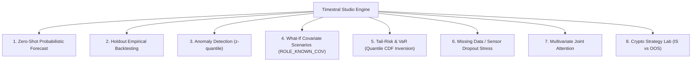

<p align="center">
  
</p>

# Timestral Studio

[](LICENSE)
[](https://www.python.org/)
[](https://www.raspberrypi.com/products/raspberry-pi-5/)
[](https://huggingface.co/collections/mistralai/timestral)
[](http://localhost:8765/docs)
[](http://localhost:8765/api/v1/agent-schema)

> **Timestral Studio** è una suite di ingegneria temporale e laboratorio predittivo basato sui foundation model **Mistral Timestral** (`Timestral-5M`, `28M`, `123M`, `209M`). Combina un'interfaccia ad alta densità per l'analisi e il benchmark con riscontro reale (*holdout empirical backtesting*), un'area dedicata al backtesting quantitativo di strategie e un set completo di endpoint API ad alte prestazioni per Agenti AI (OpenAI / Mistral Function Calling & Model Context Protocol).

---

> [!WARNING]
> ### ⚠️ DISCLAIMER FINANZIARIO / FINANCIAL DISCLAIMER
> 
> **ITALIANO**:  
> Il presente software e la sezione **Crypto Trading Workbench** (`/crypto`) sono sviluppati ed erogati **esclusivamente a scopo didattico, sperimentale e di ricerca scientifica** per studiare e validare le capacità matematico-probabilistiche dei modelli di intelligenza artificiale su serie numeriche.  
> **NON COSTITUISCONO IN ALCUN MODO CONSULENZA FINANZIARIA**, raccomandazione personalizzata di investimento, sollecitazione al pubblico risparmio o invito ad operare sui mercati finanziari. I segnali generati (BUY, SELL, HOLD), le curve di equity simulate e i parametri statistici (Profit Factor, Win Rate, Max Drawdown) sono derivati da calcoli puramente matematici e ipotetici che **non possono garantire in alcun modo risultati futuri né prevedere eventi di mercato imprevisti**. Qualsiasi operazione finanziaria reale nel mercato delle criptovalute comporta l'elevato rischio di **perdita totale o parziale del capitale**. L'autore (`BalTac`) e i collaboratori declinano ogni responsabilità, diretta o indiretta, civile o penale, per decisioni operative, transazioni o perdite economiche derivanti dall'utilizzo di questo repository o delle sue API.
>
> **ENGLISH**:  
> This project and the **Crypto Trading Workbench** (`/crypto`) are provided **strictly for educational, academic, and scientific research demonstration purposes only**.  
> **IT DOES NOT CONSTITUTE FINANCIAL, INVESTMENT, OR TRADING ADVICE (NO FINANCIAL ADVICE)**. The signals, probabilistic cones, backtests, and investment simulations are theoretical outputs of experimental machine learning models. Cryptocurrency trading involves substantial financial risk, including the loss of all invested capital. The author (`BalTac`) and any contributors assume no liability whatsoever for any actions taken or financial losses incurred based on the use of this software.

---

## Attribuzioni & Ringraziamenti

* **[Mistral AI](https://mistral.ai/)**:
  Per l'ideazione, l'addestramento e il rilascio open source dell'architettura **Timestral** (Decoupled Horizon Forecasting, patch-based causal attention e 21 quantili non incrociati). Modelli originali rilasciati con licenza Apache 2.0.
  - Articolo Tecnico: [https://mistral.ai/news/timestral](https://mistral.ai/news/timestral)
  - Repository Mistral AI: [https://github.com/mistralai/timestral](https://github.com/mistralai/timestral)
  - Hugging Face Collection: [https://huggingface.co/collections/mistralai/timestral](https://huggingface.co/collections/mistralai/timestral)
* **[Binance Public API](https://api.binance.com/)**:
  Per l'accesso pubblico alle serie storiche OHLCV utilizzate per le dimostrazioni didattiche sui cambi BTC/USDT ed ETH/USDT.
* **Autore del Progetto**:
  - **BalTac** ([GitHub @BalTac](https://github.com/BalTac)) — Architettura applicativa, runtime single-slot Raspberry Pi 5, discovery API per Agenti AI, integrazione didattica crypto e test suite.

---

## Architettura & Capacità Native

Timestral opera su sequenze causali fino a **32.768 step** di contesto temporale, producendo a ogni passo **21 quantili non incrociati**:
`0.01, 0.05, 0.10, 0.15, 0.20, 0.25, 0.30, 0.35, 0.40, 0.45, 0.50, 0.55, 0.60, 0.65, 0.70, 0.75, 0.80, 0.85, 0.90, 0.95, 0.99`

La piattaforma implementa e documenta visivamente **tutte le 7 modalità operative native**:



### 1. Zero-Shot Probabilistic Forecasting (`POST /api/v1/forecast`)
Previsione rapida con mediana (`q50`), cono di dispersione (80%, 90%, 98% CI), clamping automatico per serie non-negative e *symmetric averaging* (`clampsym`).

### 2. Holdout Benchmark su Serie Reali (`POST /api/v1/backtest`)
Separa gli ultimi $H$ punti temporali come *ground truth* nascosto, esegue l'inferenza probabilistica e calcola:
- **MAE** (Mean Absolute Error)
- **RMSE** (Root Mean Squared Error)
- **sMAPE** (Symmetric Mean Absolute Percentage Error)
- **Coverage Ratio 80% e 90%** (percentuale di verità empirica compresa nei quantili `q10–q90` e `q05–q95`)
- **Pinball Loss** aggregata
- Confronto con baseline *Seasonal Naive*.

### 3. Crypto Strategy Lab (`/crypto` · `POST /api/v1/crypto/backtest`)
- **Segnale in Tempo Reale**: Valutazione asimmetrica $q50$ (rendimento atteso) vs $q10$ (rischio di ribasso).
- **Separazione In-Sample (IS) vs Out-of-Sample (OOS)**: Verifica "al buio" su dati che il modello non ha visto per evitare trappole di *overfitting*.
- **Indicatori Quantitativi Standard**:
  - **Profit Factor**: $\frac{\text{Profitto Lordo}}{\text{Perdite Lorde}}$ ($>1.5$ soglia ottimale).
  - **Win Rate %**: percentuale trade vincenti.
  - **Max Drawdown %**: perdita massima picco-valle calcolata sulla curva equity continua mark-to-market.
  - **Sharpe Ratio**: rendimento corretto per la volatilità.
- **Simulatore Investimento Manuale (`POST /api/v1/crypto/simulate-investment`)**: Calcolo di resa base, scenari bull/bear e allerta liquidazione su posizioni con leva (1x, 2x, 3x, 5x).

---

## Discovery Directory per Agenti AI (LLM / MCP)

Tutti gli endpoint rispondono all'istante senza caricare pesi in memoria RAM:

| Endpoint | Formato | Destinatario | Descrizione |
|---|---|---|---|
| `GET /health` | JSON | AI Agent & Umani | Stato, telemetria Pi 5, modelli disponibili e sitemap |
| `GET /docs` | HTML | Umani & Dev | **Swagger UI** interattiva (OpenAPI 3.1) |
| `GET /doc` | JSON | AI Agent & Umani | Guida strutturata per agenti |
| `GET /redoc` | HTML | Umani & Dev | Documentazione tecnica **ReDoc** |
| `GET /openapi.json` | JSON | AI Agent / Tools | Specifica OpenAPI 3.1 completa in JSON |
| `GET /readme` | Markdown | AI Agent & Umani | Questo documento in formato Markdown |
| `GET /llms.txt` | Text | AI Agent / LLM | Manifesto di discovery standard per LLM |
| `GET /api/v1/agent-schema` | JSON | AI Agent | Schemi completi per **OpenAI / Mistral Function Calling** e **MCP** |

---

## Gestione Hardware & Memoria Raspberry Pi 5

Progettato specificamente per ambienti edge con risorse controllate:
* **Default Responsivo (`5M` · 21 MB)**: Inferenza istantanea su CPU (~50ms) per reattività immediata.
* **Taglie On-Demand (`28M`, `123M`, `209M`)**: Caricabili via parametro `model_size` sia da interfaccia web che da API.
* **Single-Slot Memory Policy**: Un solo modello allocato in memoria alla volta; lo switch disalloca il precedente ed esegue `gc.collect()` per non saturare la RAM.
* **Idle TTL Eviction (300 secondi)**: Dopo 5 minuti di inattività senza richieste di inferenza, il modello viene scaricato automaticamente dalla memoria RAM, riportando il processo al consumo base (~240 MB RSS).
* **Telemetria Hardware in Tempo Reale**: Monitoraggio temperatura CPU SoC, carico medio a 1m/5m e RAM di sistema tramite `/proc` e `/sys`.

---

## Installazione e Avvio Rapido

### 1. Clonazione del Repository
```bash
git clone https://github.com/BalTac/timestral-studio.git
cd timestral-studio
```

### 2. Creazione dell'Ambiente Virtuale
```bash
python3 -m venv .venv
source .venv/bin/activate
pip install -r requirements.txt
```

### 3. Avvio del Server
```bash
.venv/bin/python -m uvicorn app:app --host 0.0.0.0 --port 8765
```
Le interfacce saranno raggiungibili a:
* **Dashboard Studio Principale**: `http://localhost:8765/`
* **Crypto Workbench**: `http://localhost:8765/crypto`
* **Swagger API UI**: `http://localhost:8765/docs`

### 4. Esecuzione dei Test
```bash
.venv/bin/python test_app.py
```

### 5. Configurazione come Servizio di Sistema (systemd)
Per mantenere il servizio sempre attivo in background con avvio al boot su Linux / Raspberry Pi:
```bash
sudo cp /etc/systemd/system/timestral.service /etc/systemd/system/timestral.service # o crealo con le istruzioni incluse
sudo systemctl daemon-reload
sudo systemctl enable timestral.service
sudo systemctl start timestral.service
sudo systemctl status timestral.service
```

---

## Licenza

Questo progetto è distribuito sotto licenza **Apache License 2.0**.  
Per i dettagli completi, consultare il file [LICENSE](LICENSE).
